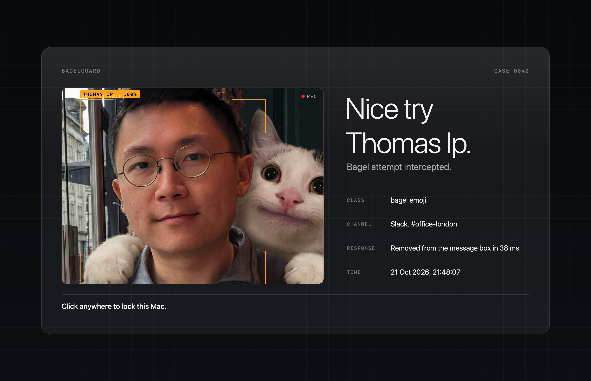

# BagelGuard

A macOS menu-bar app that stops the "bagel on an unlocked laptop" prank in Slack.



When someone puts a bagel into a Slack message box on your Mac (the 🥯 emoji, a `:bagel:`-style
shortcode, one of the custom bagel emoji, or the word "bagel"), BagelGuard:

1. clears the message box before it can be sent,
2. takes a webcam photo of whoever is at the keyboard,
3. identifies them against a lineup of known faces,
4. covers every screen with an overlay showing the photo, who they are, what was caught and where,
5. saves the photo and a copy of the overlay to `~/Pictures/BagelGuard`, and
6. locks the screen when the overlay is clicked.

It also intercepts the Return key and clicks on the Send button while a bagel is in the message box,
so even if detection is a frame behind, the message never goes out.

Reactions are not caught. The menu (🥯 in the menu bar) lets you disarm it, choose what happens on
a catch (overlay then lock, overlay only, lock right away, or only log it), turn the photo off,
preview the overlay, and start it at login. Every change in the menu, including Quit, needs Touch
ID, and anything that weakens the guard is only a pause: disarming, a milder catch action, turning
the photo off, turning off start at login, or quitting all undo themselves after 3 minutes.

## Face lineup

Drop photos into `~/Pictures/BagelGuard/Lineup/` named `Firstname Lastname.jpg`. At launch,
BagelGuard indexes every face using the SFace model (112x112 aligned embeddings, cosine similarity
threshold 0.363). When a mugshot is caught, the face is matched against the lineup and the overlay
shows who it is.

If a `-linkedin` variant exists (e.g. `Jane Doe-linkedin.jpg` alongside `Jane Doe.jpg`),
the LinkedIn version is preferred for indexing.

## Install

Requires macOS 14 or later and the Xcode command line tools (`xcode-select --install`).

```bash
./build.sh
open ~/Applications/BagelGuard.app
```

`build.sh` compiles the app and installs it to `~/Applications/BagelGuard.app`.

On first launch, grant BagelGuard **Accessibility** access when macOS asks (System Settings →
Privacy & Security → Accessibility), and allow **Camera** access for the photo.

The build is signed ad hoc, so macOS asks for Accessibility again after every rebuild. To keep the
grant across rebuilds, create a self-signed code-signing certificate named `BagelGuard Local
Signing` in your login keychain; `build.sh` uses it when it exists.

If the 🥯 icon is hidden behind the notch, open the app again (double-click it in
`~/Applications`) to get its menu at the pointer.
